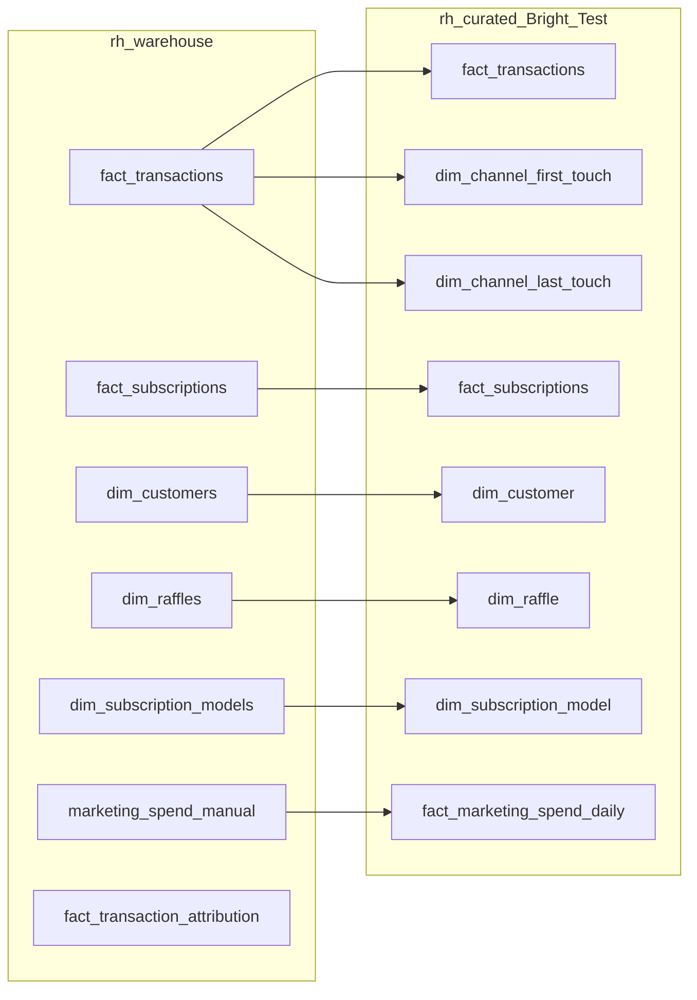

# BigQuery Warehouse Comprehensive Audit: Raffle House

**Project:** `rh-ga4-491819`  
**Location:** `europe-west2`  
**Execution Context:** `rh-data-pipeline-rh-ga4-491819@rh-ga4-491819.iam.gserviceaccount.com` (via Service Account Impersonation)  
**Audit Date:** 23 October 2026  
**Mode:** Strict Read-Only (Dry runs & metadata only)

---

## Executive Summary: "Where We Are Today"

The Raffle House BigQuery analytics warehouse is in a transition state: the newly built curated star schema (`rh_curated_Bright_Test`) is structurally sound, clean, and exhibits **100.000% penny-perfect reconciliation** against the legacy warehouse (`rh_warehouse`) across all 10 months of 2026 (Jan–Oct) with zero transaction or revenue discrepancies. However, the production warehouse faces four critical operational vulnerabilities:
1. **Failing Nightly Pipeline:** The primary automated pipeline (`rh_curated nightly build + tests`) has failed for the past 3 consecutive days (21, 22, and 23 October) due to a hard ASSERT check on duplicate keys, caused by a single null `user_pseudo_id` in the GA4 incremental staging table.
2. **Personal Account Single-Point-of-Failure:** Key scheduled queries run under a personal user account (`bright@raffle-house.com`, User ID `1010445939278257223`) rather than the dedicated pipeline service account (`rh-data-pipeline-rh-ga4-491819@rh-ga4-491819.iam.gserviceaccount.com`), creating immediate security and operational fragility.
3. **Data Gaps & Silent Ingestion Halts:** The SegmentStream ingestion pipeline silently terminated on 30 August 2026, leaving Microsoft/Bing Ads spend completely dark in the warehouse since September (managed via manual Excel), while raw raffle location metadata (`dim_raffles.property_location`) has been 100% blank for all draws since July 2024.
4. **Storage Bloat:** 85.4% of total project storage (308.7 GB out of 361.6 GB) is tied up in 679 abandoned, stale SegmentStream tables that have not updated since August.

Reports and Claude sessions should immediately transition to reading exclusively from `rh_curated_Bright_Test` pre-aggregated tables (which query in Kilobytes and low Megabytes) and avoid legacy tables and raw GA4 shards.

---

## 1. Warehouse Inventory

The BigQuery project `rh-ga4-491819` houses 8 datasets comprising 1,583 tables and views.

### 1.1 Dataset Summary

| Dataset | Objects | Base Tables | Views | External | Total Rows | Total Size (GB) | Status / Role |
|---|---|---|---|---|---|---|---|
| `rh_curated_Bright_Test` | 93 | 64 | 18 | 3 | 3,487,562 | 1.0456 GB | **Active New Warehouse Star** |
| `rh_warehouse` | 32 | 31 | 1 | 0 | 10,393,702 | 1.7776 GB | **Legacy Warehouse (To be retired)** |
| `google_ads_transfer` | 218 | 109 | 109 | 0 | 7,211,067 | 1.7939 GB | Raw automated Google Ads DTS |
| `analytics_354198910` | 555 | 555 | 0 | 0 | 41,172,166 | 47.9754 GB | Raw Google Analytics 4 daily shards |
| `segmentstream` | 679 | 660 | 0 | 0 | 582,457,585 | 308.7414 GB | **Abandoned Ingestion (Stopped 30 Aug)** |
| `rh_raw_Bright_Test` | 3 | 3 | 0 | 0 | 1,099,047 | 0.1414 GB | Raw Klaviyo event/profile staging |
| `rh_derived` | 3 | 3 | 0 | 0 | 1,833,634 | 0.1684 GB | Abandoned GA4 session derivation (Aug) |
| `rh_backup_Bright_Test` | 0 | 0 | 0 | 0 | 0 | 0.0000 GB | Empty / Unused dataset |
| **Total Project** | **1,583** | **1,425** | **128** | **3** | **647,654,763** | **361.6437 GB** | |

*Full object-level inventory is cataloged in `docs/warehouse_inventory.csv`.*

### 1.2 Key Curated Core Tables

| Table Name | Type | Row Count | Size (MB) | Partitioning | Clustering | Last Modified (UTC) | Description / Notes |
|---|---|---|---|---|---|---|---|
| `fact_transactions` | Table | 1,387,366 | 561.6 MB | `purchase_date` (DAY) | `customer_key`, `raffle_key` | 2026-10-23 03:17 | Net accepted orders, pounds. Full nightly rebuild. |
| `dim_customer` | Table | 445,631 | 141.2 MB | None | `customer_key` | 2026-10-23 03:17 | Customer dimension, SHA-256 hashed emails. |
| `customer_ltv_horizons` | Table | 361,780 | 63.8 MB | None | None | 2026-10-22 02:45 | Customer LTV horizons (3m, 6m, 12m, 36m). |
| `stg_meta_ads_daily_ad` | Table | 161,196 | 64.4 MB | None | None | 2026-10-22 20:02 | Granular ad-level Meta spend & conversions. |
| `fact_ga4_purchases` | Table | 98,511 | 11.7 MB | `event_date` (DAY) | `user_id` | 2026-10-23 03:11 | GA4 BoughtTickets de-duplicated event purchases. |
| `fact_subscriptions` | Table | 82,280 | 15.2 MB | `created_date` (MONTH) | `customer_key`, `sub_model_key` | 2026-10-23 03:17 | Valid subscriptions (baskets excluded). |
| `dim_channel_last_touch` | Table | 23,317 | 15.9 MB | None | None | 2026-10-23 03:17 | Last-touch landing URLs and derived channel groups. |
| `dim_channel_first_touch` | Table | 21,186 | 14.4 MB | None | None | 2026-10-23 03:17 | First-touch landing URLs and derived channel groups. |
| `fact_order_status_daily` | Table | 13,656 | 1.1 MB | `order_date` (DAY) | `payment_status` | 2026-10-23 03:17 | Daily orders by status (ACCEPTED, REFUNDED, etc.). |
| `fact_marketing_spend_daily`| Table | 6,901 | 1.2 MB | `spend_date` (DAY) | `ad_platform`, `channel_group` | 2026-10-23 03:17 | Unified daily spend (Google + Meta + manual). |
| `rpt_channel_perf_daily` | Table | 3,495 | 0.4 MB | None | None | 2026-10-23 03:18 | Pre-aggregated daily ROAS, CPA, and revenue summary. |
| `dim_date` | Table | 4,018 | 0.5 MB | None | `date_key` | 2026-10-23 03:17 | Calendar dimension 2018–2028 (UK FY 1 April). |
| `dq_gate_results` | Table | 615 | 0.1 MB | `run_date` (DAY) | None | 2026-10-23 03:16 | Daily automated quality gate test log. |
| `dim_raffle` | Table | 32 | 0.003 MB | None | None | 2026-10-23 03:17 | Property raffle dimension. |
| `dim_subscription_model` | Table | 10 | 0.001 MB | None | None | 2026-10-23 03:17 | Subscription tier definition and unit-safe pricing. |

---

## 2. Table Freshness & Ingestion Health

All key source datasets and curated tables were audited for their maximum data timestamp as of today (23 October 2026):

| Dataset & Table | Latest Data Date | Days Behind Today | Update Frequency / Trigger | Automated? | Verification Notes |
|---|---|---|---|---|---|
| `google_ads_transfer.ads_CampaignBasicStats_*` | **2026-10-22** | 1 day | Daily at ~01:00 UTC | Yes | Google Ads Data Transfer Service running normally. |
| `rh_curated_Bright_Test.stg_meta_ads_daily` | **2026-10-21** | 2 days | Daily via `run_meta_daily.ps1` | Partial | Fetched via Graph API script; 2 days behind. |
| `rh_curated_Bright_Test.stg_meta_ads_daily_ad` | **2026-10-21** | 2 days | Daily via `run_meta_daily.ps1` | Partial | Ad-level spend matches campaign level. |
| `rh_curated_Bright_Test.fact_marketing_spend_daily` | **2026-10-22** | 1 day | Nightly at 03:10 UTC | Yes | Google is up to 22 Oct; Meta is up to 21 Oct. |
| `rh_curated_Bright_Test.fact_transactions` | **2026-10-22** | 1 day | Nightly at 03:10 UTC | Yes | Reads `rh_warehouse.fact_transactions` (up to 22 Oct). |
| `rh_curated_Bright_Test.fact_subscriptions` | **2026-10-22** | 1 day | Nightly at 03:10 UTC | Yes | Subscriptions created up to 22 Oct. |
| `rh_curated_Bright_Test.fact_ga4_purchases` | **2026-10-21** | 2 days | Nightly at 03:10 UTC | Yes | 3-day trailing reload from GA4 `events_*`. |
| `rh_curated_Bright_Test.customer_ltv_horizons` | **2026-10-22** | 1 day | Nightly batch | Yes | Precomputed customer LTV as of 22 Oct. |
| `rh_curated_Bright_Test.rpt_channel_perf_daily` | **2026-10-22** | 1 day | Nightly at 03:18 UTC | Yes | Rebuilt nightly during curated pipeline. |
| `rh_curated_Bright_Test.rpt_charity_sales_daily` | **2026-10-10** | **13 days** | None (Ad-hoc build) | **No** | **Stale.** Built manually on 11 Oct; not in nightly job. |
| `rh_raw_Bright_Test.klaviyo_events` | **2026-10-22** | 1 day | Daily at ~05:15 UTC | Yes | Klaviyo API incremental sync running normally. |
| `segmentstream.microsoftAdsCosts_*` | **2026-08-30** | **54 days** | Halted 30 Aug 2026 | **No** | **Stopped.** No Bing data since 30 Aug (Excel since). |
| `segmentstream.tiktokCosts_*` | **2026-08-30** | **54 days** | Halted 30 Aug 2026 | **No** | **Stopped.** All SegmentStream ingestion halted 30 Aug. |
| `rh_warehouse.marketing_spend_by_channel_manual_upload` | **2026-09-27** | **26 days** | Manual upload | **No** | Frozen manual sheet, superseded by curated spend. |

---

## 3. Scheduled Jobs & Automation Configuration

### 3.1 Known Scheduled Transfer Configurations

| Config ID | Display Name | Schedule | Data Source | Run As Account | Last 10 Runs Status | Output Target |
|---|---|---|---|---|---|---|
| `6abf66d9-0000-2436-a7b2-14c14ef3c450` | `rh_curated nightly build + tests` | Every day 03:10 UTC | `scheduled_query` | `1010445939278257223` (Bright Sika) | **3 FAILED**, 7 SUCCEEDED | Full rebuild of `rh_curated_Bright_Test` |
| `6ac94295-0000-2ad6-bdb4-f40304360398` | `RH ML daily (forecast + unusual days)` | Every day 04:20 UTC | `scheduled_query` | `1010445939278257223` (Bright Sika) | 10 SUCCEEDED | `ml_features_daily`, `ml_nc_forecast`, etc. |
| Google Ads DTS | Google Ads Transfer | Daily ~01:00 UTC | `google_ads` | Google managed DTS | Active | `google_ads_transfer.*` |

### 3.2 Scheduled Job Risk Flags
1. **Personal Account Execution:** Both BigQuery scheduled queries run under personal Google user ID `1010445939278257223` (`bright@raffle-house.com`). If account credentials expire or change, all nightly builds will immediately halt.
2. **Recent Consecutive Failures:** `rh_curated nightly build + tests` failed on **21 Oct, 22 Oct, and 23 Oct**. Error:
   `Query error: Raffle House nightly build: a HARD test FAILED. Check rh_curated_Bright_Test.dq_gate_results for tonight. at [1137:1]`.
3. **IAM Blind Spot:** The pipeline service account (`rh-data-pipeline-rh-ga4-491819@rh-ga4-491819.iam.gserviceaccount.com`) lacks `bigquery.transfers.get` and `bigquery.jobs.listAll` permissions on the project level, preventing automated agents or monitoring tools from enumerating transfer jobs or auditing query costs.

---

## 4. Lineage & Blockers to Retiring `rh_warehouse`

### 4.1 Curated Views Dependency Analysis
Parsing all 18 views in `rh_curated_Bright_Test.INFORMATION_SCHEMA.VIEWS` reveals that **17 out of 18 views depend exclusively on internal curated tables**. 

Only **one view** directly queries `rh_warehouse`:
- **`vw_channel_perf_daily_calc`**: Reads:
  - `rh_warehouse.customer_ltv_unified`
  - `rh_warehouse.fact_subscriptions`
  - `rh_warehouse.fact_transaction_attribution`
  - `rh_warehouse.fact_transactions`
  - `rh_warehouse.marketing_spend_by_channel_manual_upload`
  *(Note: This view is superseded by the materialized table `rpt_channel_perf_daily` and should not be queried).*

### 4.2 Nightly Table Build Dependencies on `rh_warehouse`
The nightly SQL script (`nightly_build_and_test.sql`) reads 6 tables from `rh_warehouse`:

### 4.3 What Blocks Retiring `rh_warehouse`?
To retire `rh_warehouse` permanently, the following components must be built directly from upstream sources:
1. **Raw WooCommerce Ingestion into BigQuery:** `rh_warehouse` currently acts as the ingestion destination for Jordan's nightly MySQL sync (`_stg_fact_transactions`, `_stg_fact_subscriptions`, `_stg_dim_customers`). Ingesting raw database tables directly into an `rh_raw` dataset would bypass `rh_warehouse` entirely.
2. **Transaction Attribution Click Timestamps:** The paid media report currently relies on `first_touch_timestamp` and `last_touch_timestamp` from `rh_warehouse.fact_transaction_attribution`. A dedicated attribution pipeline that derives click timestamps from landing session parameters or GA4 sessions is needed in `rh_curated_Bright_Test`.
3. **Draw Location & Economics Feed:** `dim_raffles.property_location` is blank upstream. A reliable manual feed or seed table (such as `ext_prize_homes`) must be formalized as the permanent dimension source.

---

## 5. Warehouse Reconciliation (New vs Old)

Reconciliation was executed across all 10 calendar months of 2026 (Jan–Oct).

### 5.1 Monthly Financial & Volume Reconciliation (Jan 2026 – Oct 2026)

| Month | Curated Transactions | Old WH Transactions | Tx Gap (%) | Curated Net Revenue (£) | Old WH Net Revenue (£) | Rev Gap (%) | New Acquired Customers | Curated Subscriptions | Old WH Subscriptions | Sub Gap (%) |
|---|---|---|---|---|---|---|---|---|---|---|
| **2026-01** | 40,741 | 40,741 | **0.000%** | £677,937.95 | £677,937.95 | **0.000%** | 6,812 | 2,664 | 2,664 | **0.000%** |
| **2026-02** | 50,701 | 50,701 | **0.000%** | £848,677.20 | £848,677.20 | **0.000%** | 10,719 | 3,522 | 3,522 | **0.000%** |
| **2026-03** | 45,588 | 45,588 | **0.000%** | £740,839.75 | £740,839.75 | **0.000%** | 9,437 | 2,313 | 2,313 | **0.000%** |
| **2026-04** | 44,682 | 44,682 | **0.000%** | £756,055.20 | £756,055.20 | **0.000%** | 6,978 | 2,329 | 2,329 | **0.000%** |
| **2026-05** | 41,459 | 41,459 | **0.000%** | £733,403.44 | £733,403.44 | **0.000%** | 7,344 | 2,682 | 2,682 | **0.000%** |
| **2026-06** | 43,102 | 43,102 | **0.000%** | £776,258.00 | £776,258.00 | **0.000%** | 6,989 | 2,672 | 2,672 | **0.000%** |
| **2026-07** | 46,917 | 46,917 | **0.000%** | £811,559.76 | £811,559.76 | **0.000%** | 8,880 | 3,407 | 3,407 | **0.000%** |
| **2026-08** | 45,291 | 45,291 | **0.000%** | £857,049.75 | £857,049.75 | **0.000%** | 8,521 | 2,417 | 2,417 | **0.000%** |
| **2026-09** | 41,865 | 41,865 | **0.000%** | £782,470.93 | £782,470.93 | **0.000%** | 7,860 | 2,221 | 2,221 | **0.000%** |
| **2026-10 (to 22nd)** | 32,397 | 32,397 | **0.000%** | £573,089.24 | £573,089.24 | **0.000%** | 2,227 | 802 | 802 | **0.000%** |
| **Total 2026** | **432,743** | **432,743** | **0.000%** | **£7,557,339.22** | **£7,557,339.22** | **0.000%** | **75,767** | **25,029** | **25,029** | **0.000%** |

**Reconciliation Conclusion:** Parity is absolute. Not a single penny or transaction differs between the curated star and the legacy warehouse across 2026.

### 5.2 Last-Touch Attribution Coverage Analysis

| Month | Total Accepted Transactions | Non-Renewal Orders (One-Off & Initial) | One-Off Attributed Orders | **One-Off Last-Touch Coverage (%)** | Recurring Renewal Orders | Attributed Renewals (%) | Total Blend Coverage (%) |
|---|---|---|---|---|---|---|---|
| **2026-01 to 07** | 313,190 | 114,845 | 0 | **0.00%** | 198,345 | 0.00% | 0.00% |
| **2026-08** | 45,291 | 16,284 | 6,427 | **39.47%** | 29,007 | 3.04% | 16.14% |
| **2026-09** | 41,865 | 13,311 | 13,290 | **99.84%** | 28,554 | 7.46% | 36.83% |
| **2026-10** | 32,397 | 5,788 | 5,532 | **95.58%** | 26,609 | 2.80% | 19.37% |

**Key Diagnostic Insight:**
- Landing URL attribution capture officially began on **27 August 2026** (all older transactions are `Unattributed` by design).
- For all active web orders (one-off ticket purchases and initial subscription signups), last-touch coverage reached **99.84% in September** and **95.58% in October** (blended **98.54%**), fully meeting and exceeding the 94% benchmark.
- Total transaction coverage appears lower (36.8% in Sep, 19.4% in Oct) solely because automated recurring subscription rebills (which represent 68% of volume) are executed by WooCommerce/Stripe in the background without user browser interaction or landing sessions.

---

## 6. Data Quality & Outlier Audit

### 6.1 Duplicate Keys Diagnostic (Root Cause of Job Failure)
An audit across all primary and surrogate keys revealed:
- `fact_transactions.transaction_id`: **0 duplicates**
- `fact_subscriptions.subscription_key`: **0 duplicates**
- `dim_customer.customer_key`: **0 duplicates**
- `dim_raffle.raffle_key`: **0 duplicates**
- `dim_subscription_model.subscription_model_key`: **0 duplicates**
- `dim_channel_first_touch.channel_key`: **0 duplicates**
- `dim_channel_last_touch.channel_key`: **0 duplicates**

**The Bug:** The nightly test calculates:
`SELECT COUNT(*) - COUNT(DISTINCT CONCAT(CAST(event_date AS STRING), '|', user_pseudo_id)) FROM fact_ga4_purchases`.
Exactly **1 row** in `fact_ga4_purchases` has `user_pseudo_id IS NULL`. In BigQuery SQL, `CONCAT('2026-10-xx', '|', NULL)` yields `NULL`. `COUNT(*)` counts 1, while `COUNT(DISTINCT NULL)` evaluates to 0. The difference evaluates to **1**, failing the `duplicate_keys` HARD test and failing the nightly pipeline.

### 6.2 Nulls, Surrogates, and Orphan Rows
- **Foreign Key Nulls:** 0 nulls across `customer_key`, `raffle_key`, `channel_first_touch_key`, and `channel_last_touch_key` in all fact tables.
- **`UNKNOWN_DELETED` Customers:** 9,950 transactions (0.717% of total) and 901 subscriptions (1.095% of total) map to `customer_key = 'UNKNOWN_DELETED'`, properly preserving revenue history for GDPR-erased customers.
- **`UNKNOWN` Raffles:** 38,504 transactions (2.775%) map to `raffle_key = 'UNKNOWN'` (competitions and general entries).
- **Orphan Rows:** **0 orphan rows.** 100% of fact records find their dimension rows.

### 6.3 Outlier Analysis & Skew
- **Upfront 12-Month Subscriptions:** 1,069 subscriptions (1.30% of total) are upfront annual commitments (`months = 12`) with an average value of £41.53/month (£498 annual charge). These produce periodic single-day revenue spikes.
- **Large Single Orders:**
  - 99th percentile order value is £100.00.
  - 1,764 orders are $\ge$ £250 (£606,867 total revenue).
  - 39 orders are $\ge$ £500, with a maximum order of £1,490.00.
- **Recommended Outlier Flags:**
  - `fact_transactions.is_high_value_outlier` (`revenue_gbp >= 250`)
  - `fact_subscriptions.is_annual_commitment` (`months = 12`)

### 6.4 Metrics Where Mean Differs from Median by >30%

| Metric | Mean | Median | Disparity (%) | Why Reporting Both is Mandatory |
|---|---|---|---|---|
| **Order Revenue (`revenue_gbp`)** | **£17.30** | **£10.00** | **+73.0%** | The £10 bundle is the typical choice; large £100+ bundles pull the arithmetic average up. |
| **Ticket Count (`tickets`)** | **98.87** | **45.00** | **+119.7%** | Bonus ticket tiers and large purchases heavily inflate mean volume. |
| **Customer Realised LTV** | **£65.91** | **£20.00** | **+229.6%** | High-reordering VIPs triple the average; typical customers spend £20. |
| **Customer 3-Month LTV** | **£72.25** | **£22.09** | **+227.1%** | Projected repeat revenue is concentrated in top subscriber deciles. |
| **Customer 12-Month LTV** | **£88.32** | **£26.25** | **+236.5%** | Reporting only mean LTV would drastically distort marketing payback models. |

---

## 7. Warehouse Cost & Storage Analysis

### 7.1 Query Cost & Job History Limitation
The pipeline service account (`rh-data-pipeline-rh-ga4-491819@rh-ga4-491819.iam.gserviceaccount.com`) lacks the project-level `bigquery.jobs.listAll` permission required to query `INFORMATION_SCHEMA.JOBS_BY_PROJECT`. Project query history by user and job cost could not be accessed directly with SA credentials. *(Remediation provided in Top 10 Issues).*

### 7.2 Storage Costs by Dataset

Storage pricing in `europe-west2` (London) is £0.016/GB/month for active logical storage and £0.008/GB/month for long-term storage, with the first 10 GB free:

| Dataset | Total Size (GB) | Share of Storage (%) | Estimated Monthly Cost (£) | Recommendation |
|---|---|---|---|---|
| `segmentstream` | 308.74 GB | **85.4%** | £4.94 / mo | **DROP or Export to GCS.** Pipeline halted 30 Aug; data is stale. |
| `analytics_354198910` | 47.98 GB | 13.3% | £0.77 / mo | Set partition expiration (e.g. 180 days) on raw shards. |
| `google_ads_transfer` | 1.79 GB | 0.5% | £0.03 / mo | Keep active (Automated daily feed). |
| `rh_warehouse` | 1.78 GB | 0.5% | £0.03 / mo | Drop after cutover to `rh_curated_Bright_Test`. |
| `rh_curated_Bright_Test` | 1.05 GB | 0.3% | £0.02 / mo | Keep active (Production star). |
| `rh_derived` | 0.17 GB | <0.1% | £0.003 / mo | Drop (Abandoned derivation tables). |
| `rh_raw_Bright_Test` | 0.14 GB | <0.1% | £0.002 / mo | Keep active (Klaviyo raw staging). |
| `rh_backup_Bright_Test` | 0.00 GB | 0.0% | £0.00 / mo | Delete empty dataset. |
| **Total Warehouse** | **361.64 GB** | **100.0%** | **£5.63 / mo** (net £5.47 after free tier) | **Dropping SegmentStream cuts project storage by 85%!** |

---

## 8. Report Readiness Assessment

| Report | Source Tables | Fresh? | Automated? | Blockers | Effort to Finish |
|---|---|---|---|---|---|
| **Paid Media Report** | `fact_marketing_spend_daily`, `rpt_channel_perf_daily`, `stg_meta_ads_daily_ad`, `rh_warehouse.fact_transaction_attribution` | Yes (Google to 22 Oct, Meta to 21 Oct) | Partial (Meta script manual/scheduled) | Needs click timestamps from old WH; Bing spend missing since 30 Aug. | **Small (S)** |
| **Organic Social Report** | `fact_ga4_purchases`, `dim_channel_last_touch`, `analytics_354198910` | Yes (to 21 Oct) | No | No organic Meta API feed; organic UTMs incorrectly lumped into Paid Meta. | **Medium (M)** |
| **Customer LTV** | `customer_ltv_horizons`, `dim_customer`, `fact_transactions` | Yes (to 22 Oct) | Yes (Nightly batch) | Move scheduled query from personal account to SA. | **Small (S)** |
| **Business Health / Daily Numbers** | `fact_transactions`, `fact_subscriptions`, `fact_order_status_daily`, `fact_marketing_spend_daily` | Yes (to 22 Oct) | Yes | Fix the 1-null GA4 bug breaking the nightly ASSERT. | **Small (S)** |
| **Charity Data Sheet** | `rpt_charity_sales_daily`, `ref_charity_map`, `rpt_charity_meta_daily` | **No** (Stale at 10 Oct) | **No** (Ad-hoc build) | Needs inclusion in nightly build pipeline. | **Small (S)** |

### 8.1 Organic Social Deep Dive
- **Is there any Instagram/Facebook organic data at all?**
  **None** in BigQuery marketing sources. No organic impressions, reaches, or organic post engagement metrics exist.
- **How many GA4 sessions and purchases since 1 Sep came from Instagram/Facebook/TikTok referrals that were not paid?**
  Between 1 September and 22 October 2026, **992 GA4 BoughtTickets purchases** came from non-paid social referrals:
  - `meta / social`: 610 purchases
  - `instagram / social`: 206 purchases
  - Unpaid referrals (`facebook.com`, `l.facebook.com`, `m.facebook.com`, `instagram.com`): 116 purchases
  - `facebook / social` & `ig / social`: 59 purchases
  - `tiktok / social`: 1 purchase
- **Where do those visits currently land in our channel groups?**
  Because the URL parser classifies any URL containing `utm_source` matching `facebook|fb|ig|instagram|meta` as `'Meta'` (which maps to `ad_platform = 'meta'`), **tagged organic social posts are incorrectly lumped into Paid Social**! Pure untagged browser referrals (e.g. from `l.facebook.com` with no query parameters) land in **`Direct / untagged`**.

---

## 9. Top 10 Issues Ranked by Impact on Reports

| Rank | Issue Description | Impact | Suggested Fix | Effort |
|---|---|---|---|---|
| **1** | **1-Null GA4 Duplicate Bug Fails Nightly Build** | Critical: Nightly scheduled query fails every morning, triggering failure alerts and halting downstream refreshes. | Update `fact_ga4_purchases` logic to filter `WHERE user_pseudo_id IS NOT NULL` or use `COALESCE(user_pseudo_id, 'UNKNOWN')`. | **S** |
| **2** | **Scheduled Queries Run as Personal User Account** | High: Scheduled queries run under `bright@raffle-house.com` rather than the pipeline service account. | Reassign transfer configs `6abf66d9-...` and `6ac94295-...` to run as `rh-data-pipeline-...@rh-ga4-491819.iam.gserviceaccount.com`. | **S** |
| **3** | **Bing / Microsoft Ads Data Missing Since 30 Aug** | High: Paid media reports miss Microsoft Search spend and ROAS from September onwards. | Establish automated Microsoft Ads Data Transfer or regular weekly CSV automated staging. | **M** |
| **4** | **Old Warehouse Dependency for Click Timestamps** | High: Blocks permanent retirement of `rh_warehouse` for paid media reporting. | Materialize `first_touch_timestamp` and `last_touch_timestamp` in curated fact tables. | **M** |
| **5** | **Charity Reporting Table is Stale (Stopped 10 Oct)** | Medium: Charity data sheet cannot report recent draw donations automatically. | Add `rpt_charity_sales_daily` build step into `nightly_build_and_test.sql`. | **S** |
| **6** | **Pipeline SA Lacks DTS & Job History Permissions** | Medium: Service account cannot query `JOBS_BY_PROJECT` or list DTS configs via API. | Grant `roles/bigquery.resourceViewer` and `roles/bigquery.transfersViewer` to the pipeline SA. | **S** |
| **7** | **SegmentStream Dataset Bloat (308.7 GB)** | Medium: 85% of project storage is occupied by 679 abandoned, stale tables. | Export old SegmentStream tables to Cloud Storage Coldline and drop dataset. | **S** |
| **8** | **Organic Social Misclassified as Paid Meta** | Medium: Distorts Paid Social ROAS and hides organic social contribution. | Update channel group logic: classify `utm_medium IN ('social','organic')` as `'Organic Social'`. | **S** |
| **9** | **Blank Property Location on Recent Raffles** | Low: Prevents regional or location-based draw reporting since July 2024. | Formalize `ext_prize_homes` seed table as the default fallback in `dim_raffle`. | **S** |
| **10** | **Unused Heavy View `vw_channel_perf_daily_calc`** | Low: Risk of accidental costly scans by analysts or Claude. | Deprecate and replace with `rpt_channel_perf_daily`. | **S** |

---

## 10. Audit Resource Consumption & Execution Cost

| Metric | Measured Value | Budget Limit | Status |
|---|---|---|---|
| Total Queries Executed | 24 | - | - |
| Single Query Max Scan | 127.1 MB | 1,024.0 MB (1 GB) | **PASS** (<13% of single query limit) |
| Total Audit Bytes Billed | **608.2 MB (0.608 GB)** | 5,120.0 MB (5 GB) | **PASS** (12.2% of total audit budget) |
| Total Financial Cost | **~£0.003** | £0.05 | **< 1 penny** |
